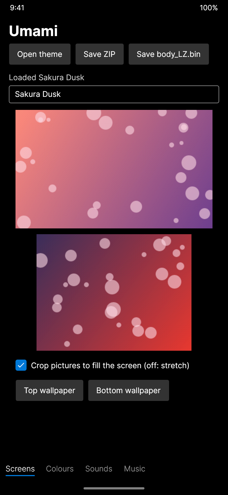
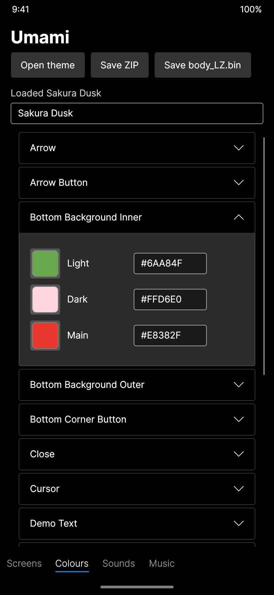
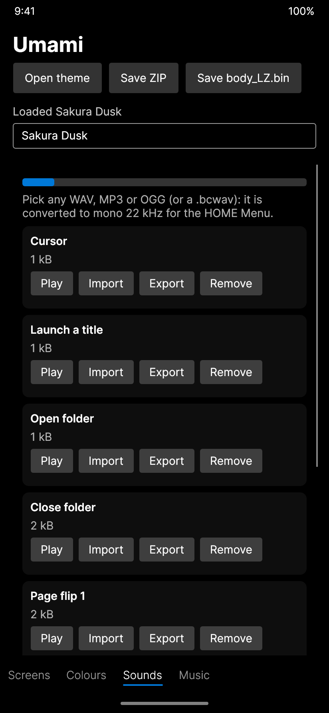
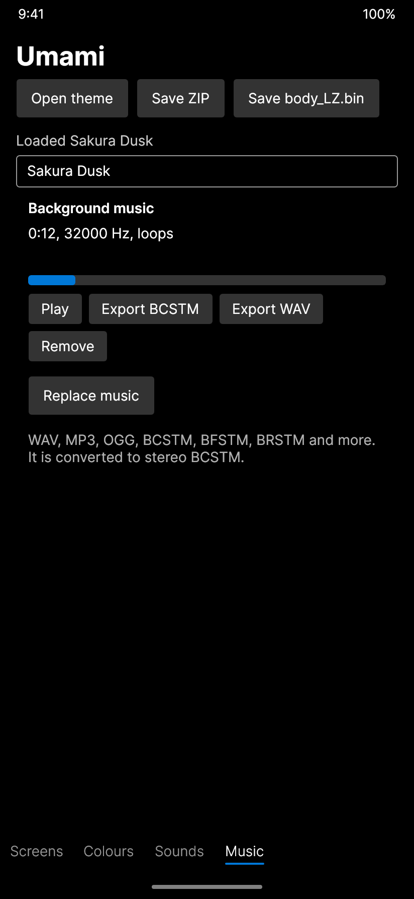

# Umami Mobile

An Android port of [Umami 3DS Theme Editor](https://github.com/BakuretsuBaka/Umami-3DS-Theme-Editor): make custom
themes for the Nintendo 3DS HOME Menu from your phone.

* Start from scratch (a new theme is ready when the app opens) or open one (`.zip` from Theme Plaza / Themezer, or a bare `body_LZ.bin`)
* Preview the top and bottom screen wallpapers
* Replace the wallpapers with any picture: it is cropped to the exact screen size for you (or stretched), or use **Both screens** to split one picture across the top and bottom screen
* Edit every colour of the theme (hex or RGB sliders)
* **Sound effects:** play, import (WAV/MP3/OGG/BCWAV), export and remove all eight HOME Menu sounds, with the size limit shown
* **Music:** import WAV/MP3/OGG/BCSTM and more, convert to BCSTM (codec, sample rate, loop), play, export, remove
* Save as a theme ZIP (with the music) or a `body_LZ.bin`

<p>




</p>

<sub>Screenshots are the real app UI rendered headlessly at phone size (412x892 dp) with a made-up sample theme; CI regenerates them.</sub>

The theme format code (LZ11, textures, theme/SMDH IO) is the same library as the desktop editor; the UI is
[Avalonia](https://avaloniaui.net/) on .NET 8. Not in the mobile version yet: the resource
library, flag editing, undo/redo and scrolling/patterned backgrounds.

## Install

Download the APK from the [latest release](https://github.com/BakuretsuBaka/UmamiMobile/releases/latest) and open it on your
Android 7.0+ phone (allow "install unknown apps" for your browser or file manager when asked).

## Building

CI builds the APK (`.github/workflows/build.yml`). Locally: install the .NET 8 SDK and JDK 17, then

```bash
dotnet workload install android
dotnet publish src/UmamiMobile.Android -c Release -f net8.0-android
```

## Credits

Based on [usagirei/3DS-Theme-Editor](https://github.com/usagirei/3DS-Theme-Editor) (MIT) and the Umami fork. MIT licensed.
